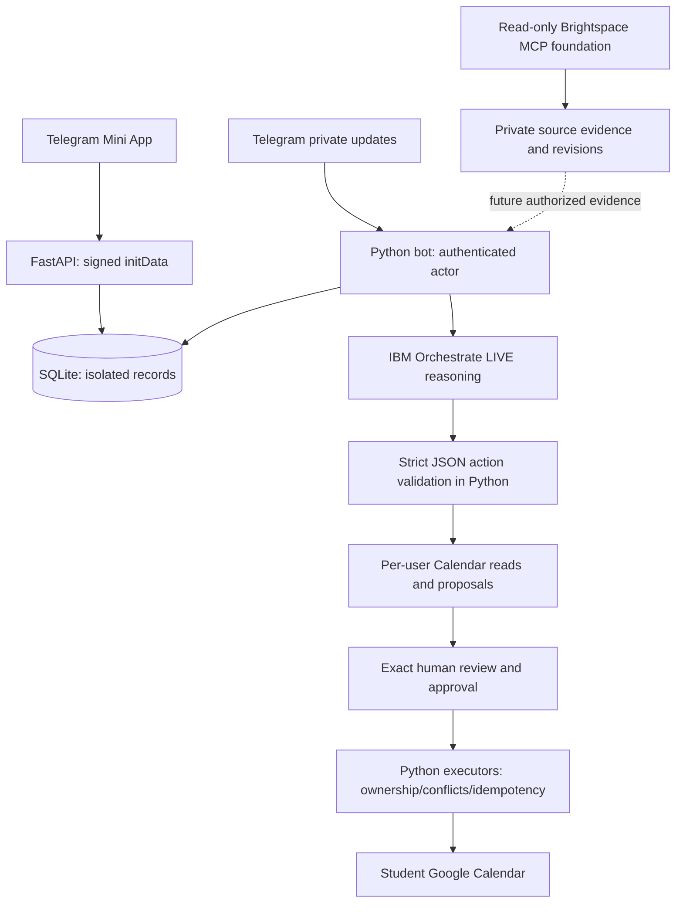

# AI Study Agent — AI IGNITION 2026

**Problem Statement 2: One Less Thing. Submission deadline: 23 October 2026.**

AI Study Agent aims to remove the repetitive work between discovering exam requirements
and actually studying: find academic evidence, decide what to revise, fit sessions around
a student's commitments, prepare useful practice, and recover when circumstances change.
Telegram is the conversation interface; the Mini App shows settings, plans, quizzes and
results. Python owns identity, memory and tools. IBM watsonx Orchestrate supplies reasoning.

This is a **sanitized development handover**, incorporating deployed source `5c28756`
plus a small, undeployed website-navigation change. It contains no live student database,
provider credentials, Google clients/tokens or school sessions. It reuses the earlier clean
publication snapshot rather than copying the private repository's history. Start with
[HANDOVER.md](HANDOVER.md) for task ownership, acceptance criteria and known defects, and
[SECURITY_AUDIT.md](SECURITY_AUDIT.md) for publication evidence.

## Read this status before evaluating the demo

| Capability | Evidence and present limits |
|---|---|
| Telegram bot / Mini App | Deployed. `/start`, navigation, settings, demonstration quizzes and saved results have prior user testing and mocked security regressions. The public homepage and privacy page work without sign-in; personal APIs require signed Telegram identity. |
| Orchestrate conversation | LIVE deployed agent and Python IAM/streaming/full-reply parsing verified. Real greetings, names and follow-up context have worked. SQLite stores bounded per-user history across restarts. |
| Conversational Calendar | Python availability, proposals, selected amendments, approvals, creation, rescheduling, cancellation and duplicate/conflict protections implemented. Earlier Runtime paths received real two-account testing; do not transfer that evidence to all Orchestrate behavior. |
| **Open Calendar defect** | After the latest repair, the real follow-up **“2 a week should be enough” could still produce an invalid tool request**. The Calendar checkpoint has 282 passing offline regressions, but complete real Telegram acceptance remains unfinished. No fix for this last report is claimed. |
| Google OAuth | Owner confirms existing project is **External / In production**. Unverified-app warning and applicable 100-new-user limit accepted. **Fresh unknown-user OAuth has not been successfully verified.** A new clone needs its own project/client. |
| Judge access | **Conversational access and temporary session controls remain limited to two testers.** `/start` and signed Mini App onboarding alone do not remove this gate. Safe public onboarding is unfinished. |
| Brightspace | Read-only MCP, owner-bound evidence/cache/extraction foundations exist. No per-student SSO/account transport, live course/exam completeness or agent integration is verified. Never reuse the developer's school account. |
| Quizzes / personalization | Demonstration MCQs, grades and progress foundations exist. Course-grounded AI-generated quizzes, durable academic/weakness memory and adaptive recommendations are unfinished. |
| Proactivity / time saved | General monitoring, academic-change replanning, proactive reminders and measured time-saved evidence are planned. Consent recovery/maintenance loops are not proof of this full workflow. |

The latest privacy checkpoint also passed 16 API/page tests. Those overlap the broader
suite; do not add counts as if they were independent. No new real Calendar or LMS actions
were performed to prepare this handover. Publication test results are in SECURITY_AUDIT.md.

## Intended student experience

Onboard in Telegram, set preferences, and optionally connect **your own** Google and
Brightspace accounts. The eventual agent will cite courses/materials/exams/deadlines,
reason about priorities and availability, propose a personal plan, accept conversational
changes and request exact approval before Calendar writes. Grounded quizzes will save
scores/mistakes and guide later revision. Opt-in monitoring should detect meaningful
academic changes, explain replanning, request new approval and send useful notifications.
A demo should show completed work and an honestly measured manual-versus-agent baseline.
Most academic retrieval/generation/proactivity steps are the roadmap, not present promises.

## Architecture



Orchestrate is **not a replacement backend**. A fixed action allowlist, JSON schemas,
server-generated call IDs and actor-bound Python references adapt its message/stream API.
The model cannot supply the authenticated user, approve itself or directly call arbitrary
Google APIs. Fresh remote threads replay only that user's bounded local context. Remote
agent tools, hooks, collaborators, knowledge and memory are refused by the current client.
Unknown/identity fields fail closed. One format repair is bounded; uncertain inference
submissions are not automatically replayed. Temporary task instructions do not save
preferences; permanent settings changes require confirmation.

Exact proposals are frozen and shown before approval. Python enforces expiry, current
review/digest, ownership, OAuth generation, conflicts, ETags and idempotent execution.
Clear whole-message approval is handled outside the model; mixed change-and-approval
messages are not consent. A model saying “created” is not evidence of a Calendar write.

## Repository map

- `backend/bot.py`: commands/callbacks, private chat, polling and maintenance tasks.
- `backend/api.py`, `backend/routes/`: FastAPI, signed Telegram auth, profile/OAuth,
  planning and LMS endpoints; public HTML is separate from authenticated records.
- `backend/database.py`, `backend/models/`: SQLite schemas and Pydantic contracts.
- `backend/services/orchestrate_client.py`, `orchestrate.py`, `orchestrate_actions.py`:
  verified LIVE transport/parser and validated reasoning/action bridge.
- `llm_providers.py`, `watsonx.py`: small provider factory and retained Runtime adapter.
- `conversations.py`, `conversation_telegram.py`: history, leases/fences, delivery/retries.
- `calendar_agent.py`, `calendar_tool_inputs.py`, `pending_proposals.py`: safe planning.
- `google_oauth.py`, `token_cipher.py`: actor-bound Google OAuth and Windows DPAPI storage.
- `planning.py`, `scheduling_core.py`, `calendar_actions.py`, `calendar_conversation.py`,
  `calendar_management.py`, `calendar_*decisions.py`, `calendar_telegram.py`: validation,
  exact approvals, consent continuation, creation/change executors and review presentation.
- `brightspace.py`, `lms_mcp.py`, `lms_retrieval.py`, `source_store.py`,
  `document_extraction.py`: read-only LMS foundation; see HANDOVER before enabling.
- `frontend/`: plain HTML/CSS/JS; no frontend build framework.
- `scripts/`: safe fresh-DB initialization, launch/health checks, opt-in live diagnostics,
  publication/history audit. `tests/`: temporary DBs and mocked Google/IBM/MCP fixtures.
- `config/*.example.json`, `.env.example`, `requirements*.txt`: independent setup inputs.

## Windows setup — use your own accounts

Verified host: Windows, Python 3.14, Git; ngrok for a stable HTTPS origin. Node.js 22+
(and browser binaries) is optional until you work on the external Brightspace MCP server.
The direct dependency pins reflect the development environment, not a full transitive lock.

```powershell
git clone https://github.com/kiakky/ai-study-agent.git
cd ai-study-agent
py -3.14 -m venv .venv
.\.venv\Scripts\python.exe -m pip install -r requirements.txt
# Extraction dependencies, needed for the complete regression suite:
.\.venv\Scripts\python.exe -m pip install -r requirements-retrieval.txt
.\.venv\Scripts\python.exe -m pip check
Copy-Item .env.example .env
Copy-Item config/deployment.example.json config/deployment.json
Copy-Item config/google_oauth.example.json config/google_oauth.json
Copy-Item config/conversation.example.json config/conversation.json
Copy-Item config/calendar_test.example.json config/calendar_test.json
```

All JSON examples are disabled. Edit only ignored local copies. Create your own bot in
BotFather, set its token and your positive numeric owner ID, and configure two known
Telegram tester IDs in `calendar_test.json` (`enabled: true`). IDs come from authenticated
updates, not model output or usernames. Do not run a second poller using the live bot token.

| Environment setting | Purpose |
|---|---|
| `TELEGRAM_BOT_TOKEN` | Required secret for your own bot/API identity validation. |
| `TELEGRAM_OWNER_ID` | Positive developer ID; template 0 deliberately prevents bot startup. Not a universal student identity. |
| `WXO_API_URL`, `WXO_API_KEY`, `WXO_AGENT_ID` | Your own Orchestrate instance, API credential and deployed agent UUID. |
| `IBM_CLOUD_API_KEY`, `WATSONX_PROJECT_ID`, `WATSONX_URL` | Optional separate legacy Runtime provider only. Original Lite quota was exhausted. |
| `WATSONX_CONVERSATION_MODEL` | Optional Runtime model override; does not select the Orchestrate model. |
| `D2L_BASE_URL`, optional `D2L_SESSION_DIR` | Your school's HTTPS origin and your private session directory; no other person's session. |
| `D2L_HEADLESS`, `D2L_NO_UPDATE_CHECK` | Visible authorized login/update behavior; see Brightspace section. |

Initialize **only a new clone database**:

```powershell
.\.venv\Scripts\python.exe scripts/init_database.py
```

This initializes current schemas (including dormant LMS tables) with no student records or
credentials and refuses an existing DB. It is not a reset/migration command. Existing-host
schema changes require a reviewed additive migration and supported private SQLite backup.
Never copy the original user's DB, virtualenv, browser profile, keychain, tokens or backups.

## Configure your own Orchestrate reasoning provider

1. Use your authorized IBM Cloud Toronto (`ca-tor`) Orchestrate instance. The verified
   adapter currently supports that host/auth type, not arbitrary MCSP/AWS/CPD endpoints.
2. Create/deploy your own conversational agent with semantic version **1.0.0**, model
   **GPT-OSS 120B via Groq** (`groq/openai/gpt-oss-120b`) and a LIVE release. These are
   deliberately pinned by the client. Different models/releases require a reviewed change.
3. Leave remote tools, memory, knowledge bases, hooks, collaborators and toolkits disabled.
   Do not import Calendar/OpenAPI/MCP tools or upload credentials into the agent. Respond
   to the application's requested JSON schemas; Python remains the execution boundary.
4. Put your instance base URL, accepted Cloud API key and canonical agent UUID in private
   `.env`, replacing all WXO placeholders. This key is used in the verified IBM IAM
   exchange; do not assume a prior Runtime project key or another deployment's credential
   type has equivalent entitlement/authentication.
5. Set private `conversation.json` to `provider: "orchestrate"`, `enabled: true`,
   `audience: "calendar_testers"`. Preserve the tester list. Restart only your own bot.

The transport exchanges IAM credentials at `https://iam.cloud.ibm.com/identity/token`,
checks LIVE environment/release metadata and calls `/v1/orchestrate/runs/stream` under
your instance base URL. It parses full assistant text and completion events, caches IAM
in memory and verifies TLS. It does not use Runtime's chat request format or keep remote
per-student thread IDs. IBM access is not transferred by cloning this repository.
The owner reports no stated LLM quota restriction for the hackathon Orchestrate access;
this is not an entitlement guarantee for a teammate's new account. IBM Bob is a separate
development aid, not a runtime dependency. Minimize unnecessary live calls.

Optional single synthetic transport check (consumes a real inference; not an offline test):

```powershell
.\.venv\Scripts\python.exe scripts/check_orchestrate.py --verify
```

Official references: [IBM API schema](https://developer.watson-orchestrate.ibm.com/apis/server_openapi.json)
and [environment authentication](https://developer.watson-orchestrate.ibm.com/environment/initiate_environment).
See [provider notes](docs/orchestrate-provider.md).

## Google Cloud OAuth — your project, your Web client

Enable Google Calendar API in your project. Configure Google Auth Platform Branding,
Audience and Data Access, using your own support email/homepage/privacy page and client:

- Requested scopes: `https://www.googleapis.com/auth/calendar.freebusy` initially;
  `https://www.googleapis.com/auth/calendar.events.owned` for approved event management.
- Create a **Web application** client with exactly
  `https://YOUR-STABLE-HOST/oauth/google/callback`; origin must match `mini_app_url`.
- Store only YOUR downloaded JSON at `backend/credentials/google_multiuser_client.json`.
  Never commit it. No extra Google JavaScript SDK/client is needed.
- Set private OAuth flags `enabled: true`; authorize enabling `event_writes_enabled`
  deliberately on your deployment. Each user connects their own account through Telegram
  Mini App → Settings → Connections and separately approves exact events.

The original project is owner-confirmed **External / In production** as of 15 October.
This permits Google users beyond the test-email list, subject to Google's controls. An
unverified warning and applicable 100-new-user lifetime cap remain hackathon limitations.
Workspace/Advanced Protection restrictions may still block accounts. Existing Testing
refresh tokens can expire and need reconnecting; publishing is not token-lifetime proof.
**Fresh unknown-user OAuth remains untested, and Telegram's separate two-tester gate
still prevents full judge conversational access.** A new Cloud project starts with its
own status; choose External/Testing plus named accounts for initial testing, then publish
manually when Branding/Data Access are ready. Do not claim verification was completed.
[Google audience/status guidance](https://support.google.com/cloud/answer/15549945?hl=en).

Google tokens use Windows DPAPI plus actor-specific entropy. API/bot must run under the
same Windows profile. General SQLite study text is not encrypted by this token mechanism.
A copied token DB is not a portable credential backup. There is no plaintext fallback.
Disconnect locally removes the active local token, not Google's grant or Calendar events;
revoke at Google separately. The privacy page explains retention and manual deletion.
The legacy owner-only `/schedule` uses a separate optional desktop client; do not configure
or invoke it for student testing. Per-user tools never fall back to that Calendar.

## Run the laptop host

Install/configure ngrok with your own account using its official instructions. In private
`deployment.json`, use your stable HTTPS **origin only** and `ngrok_executable` (PATH or your
own executable path). The launch script binds the API to loopback and disables ngrok request
inspection; do not expose OAuth URLs/initData through a traffic inspector.

Open separate PowerShell terminals from this clone:

```powershell
.\.venv\Scripts\python.exe scripts/run.py api
.\.venv\Scripts\python.exe scripts/run.py check --local
.\.venv\Scripts\python.exe scripts/run.py tunnel
.\.venv\Scripts\python.exe scripts/run.py check
# Only after HTTPS is reachable and no other poller uses this token:
.\.venv\Scripts\python.exe scripts/run.py bot
```

`/` and `/privacy` are public; `/setup` and `/study` serve HTML whose account requests
still require signed Telegram identity. Open the Dashboard menu or `/start` in your bot.
Update the two static Telegram links in `frontend/index.html` and `frontend/privacy.html`
to YOUR bot, and replace the approved original privacy-support email with YOUR operator's
contact before hosting independently. Current links point to the existing public demo bot:
[Open AI Study Agent on Telegram](https://t.me/AIStudyAgentTPBot) (conversation gated).

The bot already starts consent/maintenance/menu tasks. There is **no additional proactive
LMS worker** to start. Laptop sleep/shutdown or network loss stops access; ngrok's first-
visit notice may require a browser visit. Changing domain requires matching OAuth redirect,
private deployment config and bot menu. Preserve the operator's existing ngrok for live fixes.
The two tiny navigation links in this publication are not deployed to the original host.

## Brightspace — safe foundation, not shared student login

Never copy the original developer's Microsoft SSO, cookies, browser profiles, OS keychain,
`.private-lms`, LMS files or DB. **No student or teammate may use that personal school account.**
Use only your own institution-authorized account, normal SSO/MFA and a new private session.
The publication preserves the previously reviewed shared read allowlist, verified read-only
metadata requirement, isolated subprocess cwd, own-school origin and pinned package
`brightspace-mcp-server@3.13.18`. It now also strips `WXO_*` from the child environment.
These are publication safeguards, not new deployed LMS functionality.

For an authorized developer-only experiment on YOUR machine (not an automated test):

```powershell
$env:D2L_BASE_URL = 'https://YOUR-SCHOOL-HOST'
$env:D2L_SESSION_DIR = Join-Path (Get-Location) '.private-lms/session'
$env:D2L_HEADLESS = 'false'
$env:D2L_NO_UPDATE_CHECK = '1'
npx -y playwright install chromium
npx -y brightspace-mcp-server@3.13.18 auth
```

The package login recipe was previously inspected, not verified against every institution.
If unsupported or blocked, stop and obtain institution/upstream guidance; never borrow
someone else's session. A separate clone/OS user for a teammate's developer experiment is
not multi-user product integration. SourceStore still requires a verified administrative
owner binding; there is no public student bind endpoint. Rebinding the original account
or just removing `require_owner()` is unsafe. See HANDOVER's per-student design milestone.
Downloads default off pending transport/schema/destination verification. No write, submit,
acknowledge, mark-read or arbitrary MCP filesystem output is allowed.

## Tests, reproduction and troubleshooting

```powershell
# Optional dev/browser tools (not required to run the app):
.\.venv\Scripts\python.exe -m pip install -r requirements-dev.txt
.\.venv\Scripts\python.exe -m unittest discover -s tests -p 'test_api*.py'
.\.venv\Scripts\python.exe -m unittest discover -s tests -p 'test_orchestrate*.py'
.\.venv\Scripts\python.exe -m unittest discover -s tests -p 'test_handover_safety.py'
# Complete mocked regression suite when meaningful code changes justify it:
.\.venv\Scripts\python.exe -m unittest discover -s tests
.\.venv\Scripts\python.exe scripts/audit_publication.py --history
```

Tests patch credentials/external calls and use temporary SQLite/synthetic fixtures. The
DPAPI-specific test must run under a normal Windows user context. Optional Playwright UI
helpers need `python -m playwright install chromium` on your own machine. Do not aim preview
utilities at the live DB. `--verify` scripts make real IBM calls; never run live diagnostics
as a default suite. Real Google writes and Telegram notifications require explicit consent.

Reproduce the foundation: `/start` → Settings/own Google account → greeting/name/follow-up
→ ask for saved defaults → ask for a revision plan → review/change/reject or explicitly
approve only when willing → verify exact events in the correct Calendar → inspect saved
grades/demo quiz. Test two accounts independently. The last real “2 a week should be enough”
clarification bug is open; capture sanitized action/error metadata and add a mock regression
before changing parsing. Do not increase tool limits or let prose execute writes.

Common problems:
- Private API 401 in a regular browser is expected; reopen inside Telegram, do not bypass auth.
- No conversation for a judge: check the explicit tester/audience gates; Google Production
  does not open them. Public audience mode requires a tested authorization-preserving patch.
- Invalid tool request: strict schema rejection, including the open clarification issue;
  no approved action should execute. Inspect only safe action/result diagnostics.
- Missing/uncertain reply: bounded Telegram retries and 120-second queued-request deadline;
  provider outcomes may be uncertain. Do not replay inference or external writes blindly.
- Orchestrate config error: check own Toronto Cloud URL/key, UUID, LIVE version/model and
  forbidden remote capabilities. Other tenants/auth types need reviewed adaptation.
- Google redirect/refresh failure: exact HTTPS origin/client, granted scopes, own Windows
  DPAPI context and current consent; reconnect the owner, never another student's Calendar.
- Brightspace refusal: missing owner binding/schema/readOnlyHint or unsupported SSO; fail
  closed rather than sharing sessions or expanding to writes.

## Team workflow and publication

Keep the repository private. Teammates create feature branches and reviewed PRs, own local
accounts and fresh DBs. Coordinate one operator for the live laptop. Never start a second
poller or deploy without backup/queue checks and owner approval. Do not commit `.env`,
client JSON, tokens, DBs, logs, downloaded coursework or browser state. No paid service,
Docker/cloud migration or framework rewrite is required for this handover.

This checkpoint's authenticated GitHub publication status/commit verification is reported
in the handover response; SECURITY_AUDIT records the audited source/history. Git CLI users
may need Git Credential Manager sign-in. `scripts/publish_checkpoint.ps1` is a guarded
no-force CLI alternative; never use the obsolete initial-only script for later changes.
After initial publication, clone the remote normally rather than grafting private runtime
history onto it. No public launch or complete end-to-end hackathon readiness is claimed.