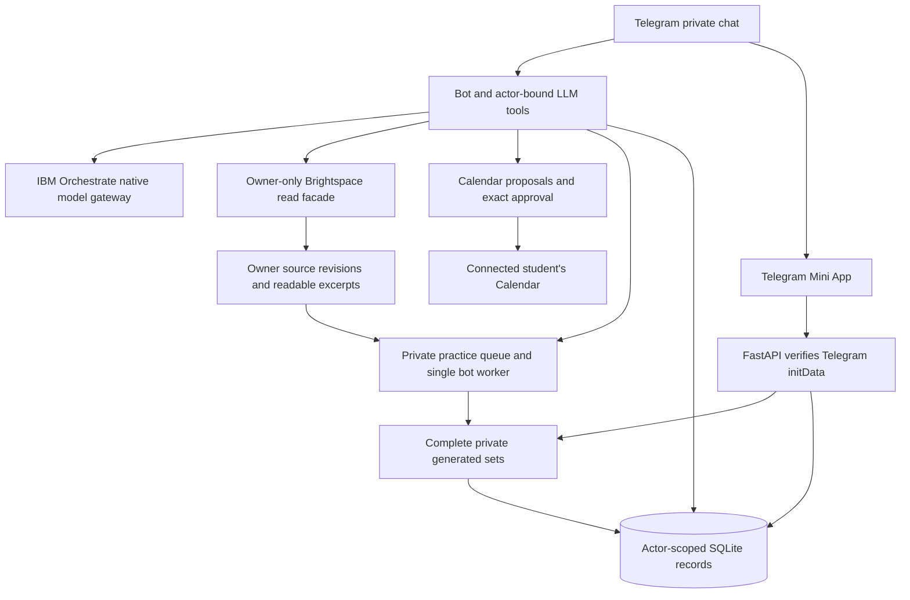

# AI Study Agent - AI IGNITION 2026

Problem Statement 2: **One Less Thing**. Submission deadline: **23 October 2026**.

A Telegram study assistant with a Mini App for private, untimed practice quizzes,
answers, results and progress. The proof of concept aims to reduce the work of
finding learning materials, planning study sessions and adapting to Calendar changes.

**Existing abbi bot:** [@AIStudyAgentTPBot](https://t.me/AIStudyAgentTPBot).
The team may keep this same public bot when a teammate takes over hosting; creating
a replacement bot is optional for independent development. Telegram hosts the bot's
public identity and chat interface, but this project's Python backend must still run
somewhere to receive messages, call tools and generate quizzes. The Mini App/API also
needs a running HTTPS host. Keeping the username does not keep the original laptop's
backend running after that laptop is turned off.

**20 October handover:** the live laptop runs application commit `f76c2d6`.
Owner Brightspace retrieval now gets far enough to save a practice request, but
that request failed during background generation. The cause is **not established**.
Nonowner uploaded-PDF quiz generation, including the Mini App, was live-tested
successfully. Do not claim the whole intended workflow is complete.

Start with [HANDOVER.md](HANDOVER.md) for the exact blocker, stop decisions, tests
already run and teammate tasks. Follow [AGENTS.md](AGENTS.md). Source code takes
precedence over older milestone documents, which describe historical states.

## What works, and what still needs proof

| Area | Implemented / evidence | Remaining limitation |
|---|---|---|
| Telegram conversation | LLM-selected tools, onboarding and actor-bound conversation context; ordinary access supports `onboarded_users` | Each clone must enable that audience; full owner/nonowner acceptance still needed |
| Brightspace | Owner-only read tools, course/material catalogs, cached source revisions, bounded document extraction | Successful real listing/reads and queued job; reliable owner quiz completion is blocked |
| Generated Practice | Private sources/jobs, generated MCQs, independent saved attempts, submission, scores and explanations; completed attempts feed actor-scoped topic-accuracy review suggestions | Nonowner PDF flow live-tested; latest owner job failed before publication; difficulty does not adapt |
| Calendar | Availability, proposals, conversational amendments and exact approvals; actor-bound create/move/cancel executors | Current complete exam-to-plan demo and conflict adaptation not established |
| Scheduled practice | Spontaneous generation is independent of Calendar/plans | Automatic session-triggered quiz delivery is not established; shared generation must work first |
| Autonomous adaptation | Existing approval cleanup and restart reconciliation | Periodic Calendar-overlap monitoring and proactive study-time notification are not established in current source |
| Mini App | Materials, Generated Practice, demo quizzes, attempts, grades and settings | Mobile polish and duplicate Telegram response cleanup remain |

Passing offline/synthetic IBM tests does not establish real-school end-to-end
reliability. The latest failure is recorded in [the handover](HANDOVER.md#current-owner-blocker).

## Scope and trust boundaries

- Anyone who onboards through `/start` should have ordinary conversational features.
- Only the configured Telegram environment owner can use that environment's
  Brightspace account, cached materials and citations. Teammates use their own
  credentials and owner configuration. Per-student Brightspace onboarding is excluded.
- Nonowners use their own pasted notes/PDFs and generic planning. Records, quizzes,
  attempts, grades and progress remain isolated by authenticated Telegram identity.
- Actual assessment evidence establishes exam dates/scope. Assignment deadlines
  are not exam dates. Without evidenced dates, propose generic study planning.
- Learning explanations must come from actual learning content, not only teaching plans.
- New quizzes belong in the Mini App. Keep answer keys private until submission;
  attempts are untimed and save independently.
- The LLM interprets requests and chooses tools. Python enforces authorization,
  validation, evidence integrity, budgets, idempotency and exact Calendar approvals.
- Adaptive difficulty, announcement monitoring, combined multi-goal requests and
  the experimental coordinator are **excluded**. Do not revive them for this demo.
- IBM is the hackathon provider. Do not replace the provider/model to mask failures.

## Overall intended proof-of-concept flow

This is the **target experience**, not a claim that every step currently works.
Reliable standalone requests are sufficient; a single combined request need not do
all of these steps at once.

1. A student sends `/start`, completes onboarding, and saves their timezone and
   study preferences. Ordinary conversation is available to onboarded users.
2. The environment owner asks for exam preparation. The LLM chooses Brightspace
   tools to inspect courses, teaching plans, assessment descriptions and relevant
   learning materials. It interprets informal subject names and weeks itself.
   Other users instead supply their own notes/PDFs; they never inherit owner access.
3. The agent identifies tests/exams from actual evidence, distinguishes assignments
   from examinations, and prioritizes nearer evidenced assessments. Teaching plans
   establish scope; explanations and questions need actual learning content.
   If no examination date is evidenced, propose a generic plan to refine.
4. For scheduling, the student connects their own Google Calendar. The agent uses
   saved preferences and actual availability to propose study sessions before the
   relevant assessment. The user can revise the proposed plan conversationally.
5. Python presents the exact Calendar changes for human review. Only explicit
   approval of those specific titles, dates, times and durations authorizes writes.
   Rejecting a proposal must leave Calendar unchanged.
6. At study time, the agent should proactively notify the student, explain concepts
   conversationally using the retrieved learning material, and provide a generated
   practice quiz in the Mini App. This scheduled trigger still needs implementation/
   verification; do not confuse a Calendar event with delivered learning support.
7. The student may also request a short quiz **now**, independently of any plan,
   Calendar connection, date range or session count. The backend qualifies learning
   evidence, saves a job, generates/validates/reviews questions, then publishes a
   complete private set. A queued job is not a completed quiz.
8. The Mini App saves each untimed attempt separately. The student can resume an
   unfinished quiz, submit it, and review scores and explanations, including wrong
   answers. Completed attempts now provide a simple per-topic accuracy summary and
   focused review suggestion; quiz difficulty itself does not adapt.
9. A periodic heartbeat should reread Calendar availability for newly introduced
   conflicts with approved study sessions, notify the affected student once, and
   offer available alternatives. Moving events requires fresh exact approval.
   Intended intervals: 5-10 minutes normally; 30-120 seconds for a supervised demo.
10. Demonstrate adaptation by manually adding an overlapping personal Calendar
    event. Show detection, proposed alternatives, a rejection with no write, and an
    approved change. This heartbeat is not established by the current maintenance
    loop, which only reconciles/cleans up existing approvals.

The developer's immediate refinement order was: owner spontaneous generation,
source-grounded quality, Telegram response cleanup, simple Mini App UI/UX, then
owner/nonowner end-to-end acceptance. Quality only needs to demonstrate learning-
material grounding for this hackathon; do not weaken authorization or fabricate content.

## Current failure and takeover priority

At about 00:00 on 20 October, an owner request for practice for GRSP's real Week 3
quiz produced the Mini App link, then the job failed with `generation_failed` and
no published set. Successful source reads and a saved request are real progress,
but they do not prove the selected learning material or final questions were correct.
The worker discarded its underlying exception; the exact cause is unknown.

The next teammate should add safe constant-stage/allowlisted-error diagnostics in
`backend/services/practice.py:run_one`, obtain permission for one live reproduction,
then reproduce that category synthetically and fix it. Do not repeat the completed
tool-limit/authentication investigations or assume another prompt change will help.
The detailed boundary, prior fixes, test evidence and constraints are in HANDOVER.

## Architecture and data ownership



Python, not the LLM or remote agent, executes tools and determines authorization.
Telegram identity comes from the private-chat sender or validated signed Mini App
launch data, never an arbitrary client/model user ID. Public static pages are not
evidence of authenticated account access. Brightspace sessions remain server-side.
The bot and API share one local database/configuration; the API alone cannot finish
generation because the practice worker runs in the bot process.

## Source-code entry points

| Path | Purpose |
|---|---|
| `backend/bot.py` | Telegram handlers, background worker startup, maintenance |
| `backend/api.py`, `backend/routes/practice.py` | Signed Mini App requests and private practice endpoints |
| `backend/services/calendar_native.py` | Main native tool loop and evidence handoff |
| `backend/services/orchestrate_native.py`, `native_progress.py` | IBM tool transport, deadline and repetition checks |
| `backend/services/lms_native.py`, `lms_retrieval.py`, `lms_mcp.py` | Owner facade, retrieval and MCP adapter |
| `backend/services/source_store.py`, `learning_text.py` | Owner evidence/revisions and readable excerpt coordinates |
| `backend/services/practice.py`, `practice_grounding.py`, `practice_store.py` | Qualification, generation/review, job worker and persistence |
| `backend/services/calendar_actions.py`, `calendar_management.py` | Approved Calendar execution and session changes |
| `frontend/` | Mini App HTML/CSS/JavaScript; no build step |
| `tests/`, `docs/` | Synthetic regressions and historical investigation/release notes |

## Independent Windows setup

For independent development, use your own clone, bot and fresh database. For shared
abbi hosting, follow the coordinated cutover instructions below instead. Never copy the live host's credentials,
SQLite database, browser profile, Brightspace session or cached school materials.
The development environment uses Python 3.14; Brightspace also needs Node.js and
the pinned `brightspace-mcp-server@3.13.18` package. Extraction dependencies are separate.

```powershell
git clone https://github.com/kiakky/ai-study-agent.git
cd ai-study-agent
py -3.14 -m venv .venv
.\.venv\Scripts\python.exe -m pip install -r requirements.txt
.\.venv\Scripts\python.exe -m pip install -r requirements-retrieval.txt
.\.venv\Scripts\python.exe -m pip check
Copy-Item config/deployment.example.json config/deployment.json
Copy-Item config/conversation.example.json config/conversation.json
Copy-Item config/google_oauth.example.json config/google_oauth.json
Copy-Item config/practice.example.json config/practice.json
```

Do not overwrite existing private configuration with these copy commands. They are
for a new clone. `scripts/init_database.py` refuses an existing database and provisions
the LMS and practice tables. Normal bot/API startup does not provision practice tables.

Create an ignored `.env` privately with your own `TELEGRAM_BOT_TOKEN` and positive
`TELEGRAM_OWNER_ID`. IBM Orchestrate uses `WXO_API_URL`, `WXO_API_KEY` and `WXO_AGENT_ID`;
obtain authorized credentials from the instance owner. Never paste secrets into chat,
source, logs or Git. Set conversation `provider` to `orchestrate`, `enabled` to true
and `audience` to `onboarded_users`; the tracked example deliberately defaults disabled.
Enable practice with exactly `{"enabled": true}` in ignored `config/practice.json`.
Configure your own stable HTTPS Mini App origin in `config/deployment.json`.

**For a brand-new clone only**, first verify `database/study_agent.db` does not exist:

```powershell
if (Test-Path database/study_agent.db) { throw 'Existing database: stop and review; do not reset it.' }
.\.venv\Scripts\python.exe scripts/init_database.py
```

Existing production databases require separate approval for backup/migrations;
do not use initialization as a repair. Google OAuth setup, Brightspace runtime
configuration and hosting rules are in [HANDOVER.md](HANDOVER.md#independent-services-and-hosting).

Start services in separate terminals after configuring your own integrations:

```powershell
.\.venv\Scripts\python.exe scripts/run.py api
.\.venv\Scripts\python.exe scripts/run.py tunnel
.\.venv\Scripts\python.exe scripts/run.py bot
```

One bot token must have **exactly one poller**. The laptop, API, bot and tunnel must
stay running. GitHub stores code; pushing does not deploy the live host. Google
OAuth publishing status also does not host the application.

## Credentials and configuration each independent host must replace

The repository provides application code, not the original operator's accounts.
Two teammates running separate bots need separate databases and independently
configured environments. A shared school/IBM entitlement needs the entitlement
owner's authorization; it does not justify sharing another person's personal secrets.

| Setting or private file | What the new environment owner supplies | What it controls |
|---|---|---|
| `.env`: `TELEGRAM_BOT_TOKEN` | Existing abbi token provisioned privately by its owner for an authorized host takeover, or a separate BotFather token for independent development | Telegram polling and Mini App signature validation; API and bot must use the same token |
| `.env`: `TELEGRAM_OWNER_ID` | Their own positive numeric Telegram user ID | The one Telegram actor allowed to use this environment's Brightspace connection |
| `.env`: `WXO_API_URL` | Authorized IBM Orchestrate instance URL | Current transport expects the Toronto IBM Cloud instance format supported by `orchestrate_client.Configuration` |
| `.env`: `WXO_API_KEY` | Authorized credential for that IBM instance | Provider authentication; never a value checked into Git |
| `.env`: `WXO_AGENT_ID` | Their authorized deployed LIVE agent UUID | Existing IBM environment/agent configuration; not a Calendar credential |
| `config/conversation.json` | Enable conversation, choose `orchestrate`, select `onboarded_users` | Ordinary user access, distinct from owner/admin rights |
| `config/practice.json` | Exactly `{"enabled": true}` after provisioning | Mini App practice endpoints and the bot's background generator |
| `config/deployment.json` | Their stable public HTTPS origin and local ngrok executable | Mini App links, trusted host and OAuth redirect origin |
| ngrok account/local authentication | Their own tunnel account configuration | Public HTTPS route to their host; the original hostname does not transfer with Git |
| `backend/credentials/google_multiuser_client.json` | Web OAuth client downloaded from their own approved Google project | Google consent exchange; keep the original downloaded private file local |
| `config/google_oauth.json` | `enabled` and `event_writes_enabled` booleans | Availability/OAuth access and whether separate event permission may be requested |
| Each student's Google grant | Student reconnects through official Google browser consent | Per-user availability/event access; never substitute the owner's grant |
| `config/brightspace_runtime.json`: `LMS_MCP_PACKAGE_ROOT` | Absolute installed MCP package directory | Must contain `package.json` for `brightspace-mcp-server` version `3.13.18` and `build/index.js` |
| `LMS_NODE_EXECUTABLE` | Absolute path to their Node executable | Launches the pinned installed MCP; no implicit latest-package download |
| `LMS_TENANT_ORIGIN` | Their authorized school's HTTPS Brightspace origin | School server boundary; no URL path/query/credentials |
| `LMS_EXPECTED_ACCOUNT` | Their own legitimate school account identifier | Upstream school account/session selection |
| `LMS_SESSION_DIR` | Their own private absolute session root | Upstream-created login/session state; do not copy the original operator's sessions |
| Owner connection binding in the new DB | Explicit owner-approved local `SourceStore` binding after legitimate authentication | Authorizes that Telegram owner to use the environment's school session |
| Optional `config/calendar_test.json` | Their own explicitly allowed tester IDs, only if using tester commands/audience | Legacy test utilities; not required to expose ordinary chat to onboarded users |
| Public identity/privacy information | Their own service operator/contact and accurate descriptions in public pages | Avoid publishing the original operator's contact as the new host's support channel |

The five `LMS_*` settings can be supplied through the supported runtime configuration
file or actual process environment. Do not assume merely adding them to a shell that
is different from the running bot configures the bot. Restart the relevant process
after deliberate configuration changes. See HANDOVER for complete JSON examples,
account provisioning, Calendar scopes and the owner-binding procedure.

Legacy `IBM_CLOUD_API_KEY`, `WATSONX_PROJECT_ID`, `WATSONX_URL` and
`WATSONX_CONVERSATION_MODEL` belong to the retained watsonx.ai Runtime path. They are
not the credentials for the current Orchestrate hackathon deployment. Do not switch
providers just because a disabled template mentions `watsonx`.

## Hosting without the original laptop

An independent host must run **all three components**: FastAPI, the Telegram bot
(including its practice worker), and a public HTTPS route to the API. It also needs
persistent writable storage, outbound Telegram/IBM/Google/school connectivity and
the owner's legitimate Brightspace browser session when that integration is used.

The current Google token cipher uses **Windows DPAPI and the same Windows user profile**.
A teammate's Windows computer or an always-on Windows host is the direct deployment
path for the existing implementation. Linux/container/serverless deployment is not
turnkey: it requires a separately reviewed token-storage replacement and compatible
Brightspace authentication/runtime. Do not remove encryption to make a new host start.

A teammate can run their own bot independently while the original laptop is off.
If they instead need to operate the **same public bot**, coordinate a single-poller
cutover and authorized secret provisioning with its owner. A clone does not acquire
that bot username/token, old Google grants or reserved tunnel hostname. Existing
users may need new Google consent and onboarding on a fresh environment. Never
overwrite/migrate the live database as an implicit part of hosting setup.

### Keeping the existing abbi bot on a teammate's host

Use [@AIStudyAgentTPBot](https://t.me/AIStudyAgentTPBot) as the public entry point;
there is no need to rename it or create another BotFather bot for a shared takeover.
Assign **one active host operator**. They run the bot process as well as the API,
practice worker and HTTPS route on their host. The existing bot token must be
provisioned privately with the bot owner's authorization into that host's ignored
configuration; GitHub will not contain it. Do not paste or retrieve it through chat.
Stop the old poller before starting the replacement with that same token.

| Component | What the replacement operator changes or verifies |
|---|---|
| Telegram identity | Keep the existing token/username only through authorized private provisioning; run exactly one poller; API uses the same token |
| Mini App | Host `frontend/` through the new FastAPI instance; set the new public origin in `config/deployment.json`; verify Dashboard menu points there |
| ngrok/HTTPS | Use an assigned hostname/tunnel under an authorized account; the original hostname is not automatically reusable |
| Google | Use the approved client for that host/origin, matching callback URI, and each student's legitimate renewed consent as needed |
| IBM | Configure an authorized Orchestrate instance/key/LIVE agent on the replacement host |
| Brightspace | Authenticate the intended environment owner's school account locally; configure runtime paths/account/origin and deliberately review owner/session binding |
| Data | Choose explicitly between a fresh environment and a separately approved migration; old attempts and Google grants do not arrive with a Git clone |

Keeping the same Telegram bot does **not** make it safe for multiple teammates to
run competing copies with different credentials. Each active deployment has one
configured Brightspace owner/account. Do not silently change `TELEGRAM_OWNER_ID`
or rebind an existing database when changing the school account. Other teammates
can keep developing with separate test bots while the designated operator hosts abbi.

For unattended operation, the assigned operator must arrange process supervision,
working directories, restart/startup order, persistent storage, private logs, host
uptime and Brightspace reauthentication access. These are deployment tasks, not
features provided by a GitHub push. The detailed cutover checklist is in HANDOVER.

## New-environment readiness checklist

1. Install dependencies, create ignored configuration and initialize a fresh DB.
   Run relevant offline tests before making any real external requests.
2. Configure the new HTTPS origin, tunnel and matching Google callback; start API
   and tunnel, then check `/health` and the public landing/privacy pages.
3. Start exactly one bot poller. Send `/start` from the owner and a nonowner.
   Open Dashboard through Telegram, not by forging signed launch data in a browser.
4. Verify the nonowner PDF/notes generation path, save/resume, submission and review.
   Verify cross-user records are denied with synthetic account tests.
5. Configure/authorize the new owner's Brightspace connection. Check read-only
   retrieval with approval, then supervise one quiz request and inspect its final
   job outcome. Do not stop at the Telegram "preparing" response.
6. Connect each student's own Google account. Test availability separately from
   exact event approval. Real create/move/cancel tests need explicit consent.
7. Verify scheduled notification/quiz and conflict adaptation only after their
   missing hooks are implemented. Record which steps passed and which remain blocked.

Expected ordinary-browser behavior: static pages and `/health` are public; private
API requests without valid Telegram data return 401. An ngrok first-visit warning
is a tunnel interstitial, not the application's Mini App. Do not weaken auth to
make browser-only probes pass. HTTP 401 from IBM/Google is a different diagnostic.

## Safe checks

```powershell
$env:PYTHONPATH='backend;tests'
.\.venv\Scripts\python.exe -m unittest test_learning_text test_practice test_quiz_refinement test_native_completion -q
.\.venv\Scripts\python.exe scripts/run.py check --local
```

The first command uses temporary/synthetic data. The reachability command expects
an already running local API. See HANDOVER for existing results before repeating
expensive suites or IBM experiments. Live scripts need explicit authorization;
never use real Calendar writes, Telegram notifications or school reads as ordinary tests.

## Demo and submission

Prioritize a truthful, recorded working slice: uploaded learning material -> generated
Mini App quiz -> saved attempt -> score/explanations, followed by separately verified
planning/approval behavior. Owner Brightspace generation and autonomous Calendar
adaptation must be demonstrated before being presented as working. Do not invent
measured time savings. Assign an operator for hosting and owners for video/slides,
submission details and final acceptance. Keep the repository private.

## Starting with another AI programming partner

Give the assistant **both this README and HANDOVER, plus AGENTS.md**, in a fresh
checkout. Ask it to inspect the actual source and Git status before changing files,
summarize the owner-generation boundary, and propose only the next small verified
step. Do not provide credentials, source caches, real transcripts or production DBs.
Use the handover's ready-to-copy task brief and evidence ledger. Historical local
commit IDs identify investigations but may not exist in a sanitized GitHub snapshot;
use file paths and the published checkpoint's actual commit as the new baseline.

The documentation was reviewed before the developer authorized the source update.
A GitHub publication is separate from deployment of the running bot. "Entire project"
means current source, safe templates, tests and documentation; private environment
state is intentionally excluded and must be recreated by each authorized host.
