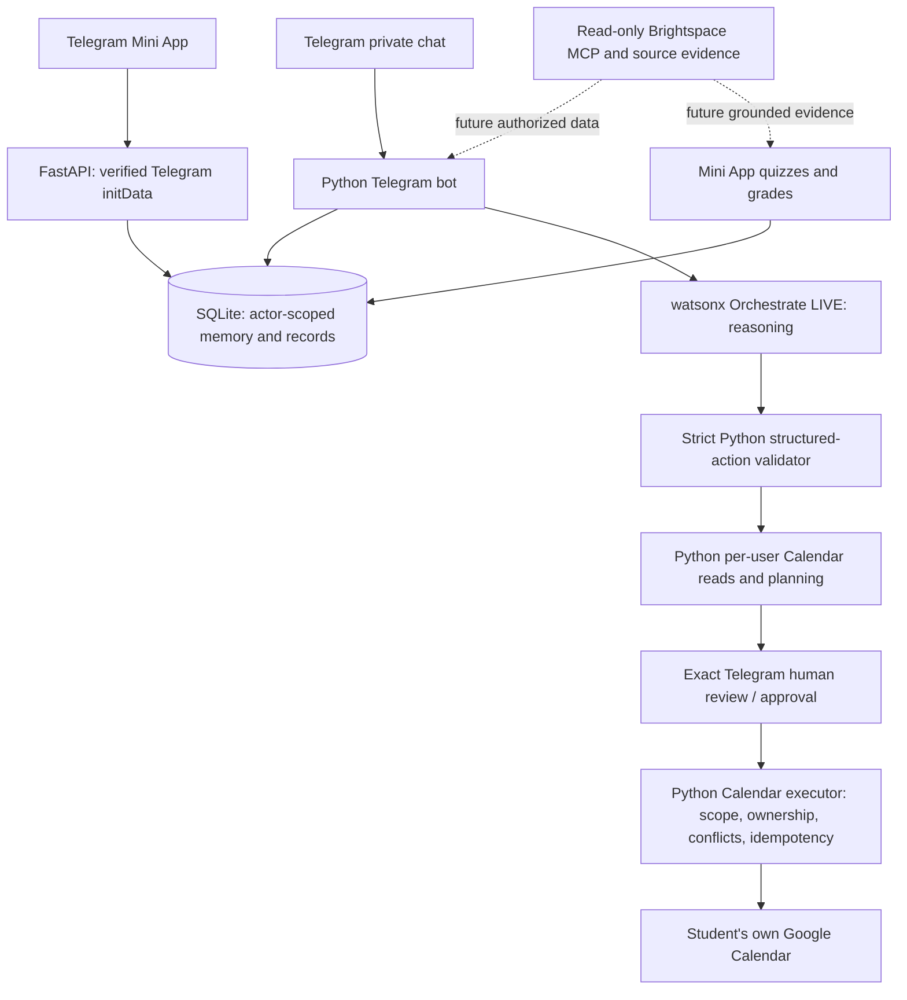

# AI Study Agent — AI IGNITION 2026

**Problem Statement 2 — “One Less Thing”**  
**Submission deadline:** 23 October 2026  
**Repository:** <https://github.com/kiakky/ai-study-agent> (private)

AI Study Agent is an autonomous exam-preparation assistant intended to reduce the manual work between finding academic requirements and actually studying. Students interact conversationally through Telegram and use a Telegram Mini App for settings, plans, quizzes and grades. The eventual agent will consult authorized, read-only academic evidence; propose useful study sessions around actual availability; request permission before Calendar changes; deliver course-grounded practice; notice meaningful academic changes; and measure work saved.

**This repository is a sanitized development handover, not proof of a complete judge-ready application.** It represents the application source deployed at `5c28756` plus a small, **not-yet-deployed** public-site navigation update. It deliberately excludes live data, user sessions, API keys and OAuth credentials. The original live app is separately hosted on a Windows laptop. A `git push` does not deploy it.

Read **[HANDOVER.md](HANDOVER.md)** for the immediate work assignments, actual known bugs, acceptance criteria, development dependencies, and safe transfer of public hosting. Read **[SECURITY_AUDIT.md](SECURITY_AUDIT.md)** for the sanitized snapshot's publication checks. Consult **[AGENTS.md](AGENTS.md)** and the relevant `docs/` files before changing sensitive code.

## New teammate quick start — first 30 minutes

**Start from this repository's current `main` branch**, not an older downloaded README,
private development worktree or the operator's live Windows folder. Read this quick start,
then [HANDOVER.md](HANDOVER.md) for the ordered tasks and acceptance criteria. This code
is a sanitized **development checkpoint**, not a deployed, judge-ready finished agent.

1. **Confirm repository access and coordinate ownership.** Accept the GitHub invitation,
   clone your own checkout, and create a feature branch. Agree on an owner for each workstream
   in HANDOVER before editing shared modules; use pull requests to integrate work. Do not
   push directly to `main` without team review.
2. **Set up an independent local environment.** Follow [Windows setup](#independent-windows-setup--do-not-ask-for-the-original-operators-secrets)
   and use only the `.example` templates to create ignored local configuration. Start with
   a fresh synthetic SQLite database. Do **not** request the original developer's `.env`,
   actual SQLite database/backups, Google client JSON, Orchestrate API key, Microsoft SSO
   session/cookies, downloaded school content or Windows user profile.
3. **Prove the foundation without credentials first.** Install the Python requirements,
   initialize a **new** database, and run the offline tests in
   [Tests, reproduction and troubleshooting](#tests-demonstrations-and-troubleshooting).
   Learn the code paths listed in [Repository map](#source-code-map--where-to-look). Don't run live IBM,
   Google or Brightspace diagnostics merely to check that the clone works.
4. **Configure only the services you own or are authorized to use.** Create your own Telegram
   bot, Google Cloud OAuth client and/or IBM Orchestrate agent following the sections below.
   The original Google project being *In production* does not publish your new project.
   Use your **own school account** for Brightspace experiments; the existing owner-bound MCP
   connector is not safe multi-student authentication. If an account, permission or
   institution's SSO is unavailable, develop against explicit synthetic fixtures and
   document the limitation rather than borrowing credentials.
5. **Do not collide with the live host.** The operator's laptop currently runs the public
   demo. Never launch a second poller against its Telegram bot token, point synthetic tests
   at its live DB, change its OAuth redirect/host, or deploy a local branch without the
   operator's approval and verified backup. A local clone and the live deployment are
   separate environments.
6. **Choose the next action from HANDOVER.** Judge-access gating and broken conversational
   Calendar clarification are known release blockers; Brightspace, grounded quiz generation
   and change monitoring are unfinished features. Demonstration quizzes are *not* AI-generated
   from courses. Record the exact tested behavior in your PR; do not call a feature complete
   solely because offline unit tests pass.

### Local development is not live-bot hosting

Every teammate may run an **independent** clone with their own BotFather bot/token,
local SQLite, FastAPI and ngrok tunnel, plus authorized IBM/Google settings. This will
**not** run or update the existing public `@AIStudyAgentTPBot`: a Telegram bot's public
username is bound to its token, and the published GitHub repo intentionally has no
production credentials or user data. **Never run two `getUpdates` pollers with the same
bot token.** See [HANDOVER — Live-host ownership and migration](HANDOVER.md#live-host-ownership-and-migration--read-before-the-original-laptop-goes-offline)
for the required operator/cutover process. Google Cloud's OAuth *In production* status
is consent configuration, **not application hosting**. The existing ngrok domain also
belongs to its own ngrok account and does not follow the Git clone.

**How to access the current demo:** [Telegram bot](https://t.me/AIStudyAgentTPBot),
[public homepage](https://lavender-arena-barrier.ngrok-free.dev/) and
[privacy policy](https://lavender-arena-barrier.ngrok-free.dev/privacy).
The host must be running. `/start` and Mini App access do not imply public Orchestrate
conversation/Calendar access: those actions are currently limited to two configured testers.
Unknown Google users may attempt OAuth because the existing project is *In production*, but
fresh-user consent and full public Telegram onboarding still require testing/engineering.

**Team rule:** First deliver a small, verified, demoable end-to-end slice that preserves
real identity isolation, read-only Brightspace access and human approval for Calendar writes.
Then extend breadth if time remains. See the acceptance matrix and showcase scenario in
[HANDOVER.md](HANDOVER.md). The final project must honestly distinguish working features,
partially working functionality and clearly labeled synthetic demonstrations.

## Current project status — read before coding or judging

| Capability | Verified status / important limitation |
|---|---|
| Telegram bot and Mini App | `/start`, Dashboard, settings, demonstration quizzes, saved attempts/results and owner-isolated records have previous phone or mocked-test evidence. Public static homepage/privacy pages are available when the host is online. |
| IBM watsonx Orchestrate | LIVE `AI Study Agent - POC` v1.0.0 using Groq-hosted GPT-OSS 120B; IAM exchange, streaming reply parsing, real greetings, retained nicknames and separate bounded SQLite conversation context have worked. |
| Calendar tools | Python implements actor-bound availability, proposals, selected pending amendments, exact human approvals, creation, rescheduling, cancellation, idempotency/conflict protections and OAuth. **Current Orchestrate conversational Calendar path is NOT end-to-end verified.** |
| **Known scheduling bug** | In real Telegram acceptance, a two-week machine-learning request led to clarification; the follow-up **“2 a week should be enough”** returned **“The model returned an invalid tool request.”** The repair commit `2414915` had 282 passing offline regressions, but this issue remains open. |
| Google OAuth | The original operator set Google Auth Platform to **External / In production**. An unverified-app warning and applicable 100-new-user cap are accepted limitations. **A previously unlisted new user's complete consent/callback has not been verified.** A cloned project uses its own client/configuration. |
| **Public judge access** | Anyone can open the Telegram username, but **IBM conversation and conversational Calendar paths are still restricted to two configured testers**. `/start` and Mini App onboarding alone do not fix this. |
| Brightspace | Reusable, strictly read-only MCP and source/evidence/extraction infrastructure exists. Secure independent student SSO/session onboarding and complete live LMS-backed reasoning are **not implemented or verified**. No personal Brightspace credentials are transferred. |
| Quizzes and learning | Demo multiple-choice quizzes and persistent grades exist. AI-generated quizzes grounded in actual course evidence, durable weak-topic profiles and adaptive recommendations remain unfinished. |
| Monitoring and time saved | True proactive academic-change monitoring, change-triggered replanning, reminders and measured time-savings reports are planned rather than delivered. |
| Hosting | Current public bot/API/Mini App run on one Windows laptop, with one Telegram polling process, FastAPI and ngrok. Neither Google OAuth Production nor GitHub hosts the Python application. |

**Do not represent simulated, mocked or planned functionality as if it passed a real user test.** The 282-test figure is historical offline evidence from the Calendar repair; current publication-specific results are in `SECURITY_AUDIT.md`. Previous Calendar testing under the older watsonx.ai Runtime provider does not prove current Orchestrate scheduling works.

## Project and public demonstration links

- [Telegram bot — @AIStudyAgentTPBot](https://t.me/AIStudyAgentTPBot)
- [Public homepage](https://lavender-arena-barrier.ngrok-free.dev/)
- [Privacy policy](https://lavender-arena-barrier.ngrok-free.dev/privacy)
- [Developer handover and immediate assignments](HANDOVER.md)

These public links work **only while the original laptop, services, internet connection and ngrok tunnel are running**. A free ngrok first-visit warning may appear. The original public site's new Telegram navigation links exist in the GitHub source but were not deployed by the handover checkpoint.

## Intended end-to-end student experience

1. A student opens the Telegram bot and onboards into their own account.
2. The agent recalls their preferences, course interests, strengths, weaknesses and schedule constraints from authorized local context.
3. The student connects their own Google Calendar and optionally their own Brightspace account.
4. The agent reads their Brightspace courses, materials, announcements, exam dates and deadlines **without ever modifying the LMS**, preserving source references and uncertainty.
5. IBM Orchestrate reasons over the student's request, academic evidence, study preferences and availability.
6. The agent proposes concrete personalized revision priorities and a plan.
7. Python checks Google Calendar free/busy, dates, time zones and conflicts; exact proposed study sessions are displayed.
8. The student can modify individual sessions naturally and must explicitly approve any consequential change.
9. Python creates, moves or cancels only approved, student-owned Google Calendar events; no LLM can approve actions by itself.
10. The Mini App presents AI-generated quizzes grounded in cited course content and exam relevance.
11. Scores, missed concepts, explanations and weaknesses persist to guide subsequent revisions.
12. With user consent, the system monitors relevant academic changes and detects meaningful new/updated exam information.
13. The agent explains changed source evidence, revises recommendations and obtains fresh approval before changing Calendar events.
14. Telegram delivers useful reminders and change notifications with appropriate rate limits.
15. The demonstration shows verified tasks completed and honest manual-versus-agent time-saved evidence.

The above describes **the full intended product**, not a claim that every step is currently implemented. See the status table and [HANDOVER](HANDOVER.md) for feature-by-feature acceptance requirements.

## Architecture and trust boundaries



**Python owns** Telegram identity, FastAPI authentication, SQLite records, user isolation, Google OAuth, all executable tools, approvals, quiz storage, monitoring and notifications. **IBM Orchestrate reasons and requests allowlisted internal actions.** It does **not** replace the Python backend, store authoritative per-user state, approve writes, or use uploaded remote Calendar tools. Normal user messages may contain personal text; the application filters credentials and privileged identity data from tool context. The external provider's own retention is not represented as zero.

Orchestrate uses a strict locally validated JSON-action interface because its verified streaming interface did not expose the existing Runtime-native tools in the same way. A single bounded format-repair attempt can correct malformed LLM output; unknown actions or forged actor fields fail closed. Python supplies date/time validation and actual Calendar availability, and only human-confirmed actions pass to the executors. Temporary scheduling instructions override defaults for the task, not permanently saved preferences.

## Source-code map — where to look

| Area | Main files / folder | Role |
|---|---|---|
| Telegram | `backend/bot.py`, `backend/services/conversation_telegram.py` | Polling, commands/callbacks, LLM conversation, maintenance and safe delivery. |
| HTTP / Mini App | `backend/api.py`, `backend/routes/`, `frontend/` | FastAPI, Telegram-signed requests, Settings, dashboard, quiz/grade UI, public pages, OAuth callback. |
| Persistence | `backend/database.py`, `backend/models/`, `backend/services/` | SQLite schema and actor-owned records, conversation/context, approvals/outbox and quiz attempts. |
| IBM | `backend/services/orchestrate_client.py`, `orchestrate.py`, `orchestrate_actions.py`, `llm_providers.py`, `watsonx.py` | Provider selection, IAM, LIVE streaming, JSON validation and retained legacy Runtime option. Find actual paths under `backend/services/` before imports. |
| Planning / Calendar | `calendar_agent.py`, `calendar_tool_inputs.py`, `pending_proposals.py`, `planning.py`, `scheduling_core.py`, `calendar_actions.py`, `calendar_management.py`, `calendar_conversation.py`, `calendar_telegram.py`, `calendar_*decisions.py` | Availability, proposal construction, exact review/approval, event execution, session changes and protections. |
| OAuth | `google_oauth.py`, `token_cipher.py`, `config/google_oauth.example.json` | Actor-scoped OAuth, PKCE/state/redirect/connection generation and Windows DPAPI credential protection. |
| Brightspace | `brightspace.py`, `lms_mcp.py`, `lms_retrieval.py`, `source_store.py`, `document_extraction.py` | Read-only MCP tool boundary, owner verification, source ingestion and evidence; **not** public student SSO. |
| Startup / quality | `scripts/`, `tests/`, `config/*.example.json`, `.env.example`, `docs/` | Boot/health checks, offline regression tests, sanitized fixtures, provider and design notes. |

Several module names above are abbreviated rather than full import paths: search the repository for the named file/service before editing. Consult [HANDOVER](HANDOVER.md) for the exact entry points and constraints; do not duplicate an existing Calendar executor just to add LLM behavior.


## Independent Windows setup — do not ask for the original operator's secrets

The development host was verified on **Windows with Python 3.14**; use that version for best reproducibility. Install Git, Python and optionally Node.js 22+ for the external Brightspace MCP package. An IDE is optional. The project uses plain frontend files without a frontend compilation step. Dependencies are pinned directly, not a full transitive lock.

From a new PowerShell terminal:

```powershell
git clone https://github.com/kiakky/ai-study-agent.git
cd ai-study-agent
py -3.14 -m venv .venv
.\.venv\Scripts\python.exe -m pip install -r requirements.txt
.\.venv\Scripts\python.exe -m pip install -r requirements-retrieval.txt
.\.venv\Scripts\python.exe -m pip check
Copy-Item .env.example .env
Copy-Item config/deployment.example.json config/deployment.json
Copy-Item config/google_oauth.example.json config/google_oauth.json
Copy-Item config/conversation.example.json config/conversation.json
Copy-Item config/calendar_test.example.json config/calendar_test.json
.\.venv\Scripts\python.exe scripts/init_database.py
```

`init_database.py` is for **new, empty clones**. It refuses an existing database: do not reset or overwrite an existing student database to fix an error. Never copy the operator's `.env`, `.venv`, personal Windows profile, SQLite DB/backups, Google OAuth client JSON/tokens, school documents, browser cookies or `.private-lms` folder. All local configuration files are ignored by Git.

### Required private configuration

| Where | Setting / file | How to obtain it; precautions |
|---|---|---|
| `.env` | `TELEGRAM_BOT_TOKEN` | Create a **new developer bot** via Telegram **@BotFather**. Never run an independent clone using the live public bot's token. |
| `.env` | `TELEGRAM_OWNER_ID` | Your own positive Telegram numeric user ID, not a universal student ID or model-supplied value. |
| `.env` | `WXO_API_URL`, `WXO_API_KEY`, `WXO_AGENT_ID` | Your approved watsonx Orchestrate Cloud instance URL, credential and deployed LIVE agent UUID. Request access from the instance administrator or configure your own; never copy another person's key. |
| `.env` (legacy optional) | `IBM_CLOUD_API_KEY`, `WATSONX_PROJECT_ID`, `WATSONX_URL`, `WATSONX_CONVERSATION_MODEL` | Legacy watsonx.ai Runtime integration only; the original Lite monthly quota was exhausted. These are not an Orchestrate substitute. |
| `.env` (Brightspace optional) | `D2L_BASE_URL`, `D2L_SESSION_DIR`, `D2L_HEADLESS`, `D2L_NO_UPDATE_CHECK` | Your own school's authorized LMS origin and private browser session. Never supply another student's session or login. |
| Private JSON | `config/deployment.json` | Your HTTPS `mini_app_url` (origin only) and local `ngrok_executable`. No secret in the file. |
| Private JSON | `config/google_oauth.json` | Your own Google OAuth feature flags. Do not enable real event writes until properly tested/approved. |
| Private JSON | `config/conversation.json` | Set `provider: "orchestrate"`, `enabled: true` and `audience: "calendar_testers"` for initial restricted tests. Public audience requires separate code and safety testing. |
| Private JSON | `config/calendar_test.json` | Your own authorized numeric Telegram tester IDs and corresponding feature gating. |

Always inspect the example files for the exact current schema. Do not invent JSON keys. Local tests should use synthetic identities and temporary databases instead of live secrets. The template owner ID is deliberately not usable until configured.

### Set up IBM watsonx Orchestrate reasoning

1. Use an IBM watsonx Orchestrate instance you are authorized to access. The verified adapter expects the Cloud Toronto (`ca-tor`) URL/authentication pattern; different deployments are not guaranteed compatible.
2. Create or access the intended Orchestrate conversational agent and deploy a **LIVE** version **1.0.0**, using **GPT-OSS 120B via Groq** (`groq/openai/gpt-oss-120b`). The Python client checks that the expected agent/version/model is selected.
3. Obtain `WXO_API_URL`, a compatible `WXO_API_KEY` and the canonical `WXO_AGENT_ID`. The URL is the instance base URL, not a guessed endpoint path. Keep keys local in `.env`.
4. Leave remote memory, tools, knowledge, hooks, collaborators and toolkits **disabled** for the existing architecture. Python handles identity, memory and Calendar tools; don't rebuild or upload them into Orchestrate.
5. In ignored `config/conversation.json`, enable the Orchestrate provider for your permitted test audience. Start the bot and verify a normal greeting before attempting Calendar workflows.

Transport: the Python adapter obtains an IAM token from `https://iam.cloud.ibm.com/identity/token`, validates the LIVE agent release, and calls the instance's `/v1/orchestrate/runs/stream`, assembling the streamed assistant reply. Orchestrate's structured action response is validated locally in Python. Remote-model native tool support is **not** assumed.

Optional **real inference** smoke check (not an offline test; use sparingly):

```powershell
.\.venv\Scripts\python.exe scripts/check_orchestrate.py --verify
```

See [`docs/orchestrate-provider.md`](docs/orchestrate-provider.md), the [IBM OpenAPI schema](https://developer.watson-orchestrate.ibm.com/apis/server_openapi.json) and [IBM environment documentation](https://developer.watson-orchestrate.ibm.com/environment/initiate_environment). The hackathon organizer previously indicated Orchestrate did not have the old Runtime 300,000-token quota; that does not guarantee unrestricted capacity on independently configured accounts.

### Configure your own Google Calendar OAuth

1. In your own Google Cloud project, enable the **Google Calendar API**.
2. In **Google Auth Platform**, complete Branding, Audience and Data Access with **your own** support contact, public homepage and privacy policy; don't reuse the original operator's personal Gmail.
3. Create a **Web application OAuth client** and authorize exactly your own HTTPS redirect: `https://YOUR-STABLE-HOST/oauth/google/callback`. The origin must match your private `mini_app_url`.
4. Request the least-privilege scopes used by this project: `https://www.googleapis.com/auth/calendar.freebusy` for reads and `https://www.googleapis.com/auth/calendar.events.owned` when users separately authorize exact event management.
5. Store the downloaded OAuth client JSON **only** at the private path `backend/credentials/google_multiuser_client.json` (as expected by the current source); never commit it. Use the private `config/google_oauth.json` flags to enable the connection and deliberately decide whether event writes are permitted.
6. Connect a Google account inside **Telegram Mini App → Settings → Connections**, authorize that account and verify the callback. Calendar event creation always needs a separate explicit in-app/Telegram approval; OAuth consent itself never authorizes a write.

The **original** Google project is already **External / In production**, with an accepted unverified-app warning and applicable 100-new-user cap. This status **does not transfer to your new Cloud project**. A previously unlisted third account's complete authorization has **not** yet been acceptance-tested. Domain changes require updating the Google Web-client redirect, Branding and the bot's Mini App URL, not just changing an environment variable. Google can impose additional organizational/account restrictions.

Google OAuth tokens in the existing app are protected with **Windows DPAPI and actor-bound entropy**. The API and bot must run in the same Windows user context. Copying another machine's SQLite database will not make its tokens usable on your computer. Disconnecting locally does not revoke Google-side permissions or delete Calendar events; users may revoke grants in their Google account separately. General SQLite study text is **not** encrypted by the DPAPI token mechanism. See the privacy policy for retention and manual deletion limitations.

### Brightspace read-only MCP — developer experiment, not production student onboarding

The project includes a reviewed read-only MCP tool allowlist and source/evidence handling, but not a safely deployable per-student Microsoft SSO connection. **Every student/developer must use their own institution-authorized login and private browser session.** Never ask to borrow the original operator's Microsoft SSO session, cookies, credentials or downloaded school documents. If blocked by institutional approval, use explicitly labelled synthetic course data.

The examined external package is pinned to `brightspace-mcp-server@3.13.18`, with no-update checking; Node.js 22+ and Playwright Chromium may be required. Example **own-account** commands, after reviewing the package requirements:

```powershell
$env:D2L_BASE_URL = 'https://YOUR-SCHOOL-HOST'
$env:D2L_SESSION_DIR = Join-Path (Get-Location) '.private-lms/session'
$env:D2L_HEADLESS = 'false'
$env:D2L_NO_UPDATE_CHECK = '1'
npx -y playwright install chromium
npx -y brightspace-mcp-server@3.13.18 auth
```

Do not assume those commands work for every school's SSO. The current `SourceStore` still enforces an explicit `developer_session`/owner binding, and merely removing that guard or changing `D2L_BASE_URL` would be **unsafe**. The MCP wrapper checks `readOnlyHint: true` and denies unrecognized, write, submission, acknowledgement, mark-read or arbitrary-output actions. Downloads default **off** pending verification. See [HANDOVER](HANDOVER.md#priority-p1--read-only-brightspace-with-student-owned-sessions) for the multi-student design and tests.

## Run an independent local application

Install and configure [ngrok for Windows](https://ngrok.com/download/windows) under **your own account**. Reserve/configure a stable HTTPS hostname and set it as `mini_app_url` in your private `config/deployment.json`. Put the executable path in `ngrok_executable` (or `ngrok` when available on PATH). Do not tunnel the preview server, SQLite DB, development admin port or HTTP inspection interface.

From separate PowerShell terminals in the project root, run in this order:

**Terminal 1 — FastAPI / frontend**

```powershell
.\.venv\Scripts\python.exe scripts/run.py api
.\.venv\Scripts\python.exe scripts/run.py check --local
```

**Terminal 2 — HTTPS tunnel**

```powershell
.\.venv\Scripts\python.exe scripts/run.py tunnel
.\.venv\Scripts\python.exe scripts/run.py check
```

**Terminal 3 — Telegram bot** (only if no other process polls **your** token)

```powershell
.\.venv\Scripts\python.exe scripts/run.py bot
```

This normally launches one FastAPI service on `127.0.0.1:8000`, one ngrok tunnel and **one Telegram polling process**. Keep the laptop powered on, awake and online for any public demo. The bot sets/refreshes its Dashboard menu; `/start` exposes a button as a fallback. The Mini App/Google callback will not work if FastAPI or ngrok stops; Telegram messages won't be answered if the bot stops. T3 Code/VS Code are not hosting requirements.

**Do not run the original public bot token from an independent clone.** The public `@AIStudyAgentTPBot` identity will not be recreated by cloning the repo. If you are the designated operator taking over the public bot, follow [HANDOVER — Live-host ownership and migration](HANDOVER.md#live-host-ownership-and-migration--read-before-the-original-laptop-goes-offline) before starting any process. Only one poller worldwide should use that token. Likewise, the original ngrok hostname belongs to its account, not to GitHub. Google OAuth Production is consent configuration, not an app server.

The publicly accessible homepage `/` and policy `/privacy` are informational. Authenticated student routes validate signed Telegram `initData`. The normal service disables `/docs`, `/redoc` and `/openapi.json`; do not bypass private API 401s. The free ngrok HTML interstitial may interrupt first-time mobile visitors; test inside Telegram WebView, not just in desktop incognito.

To stop an independent clone, stop tunnel/bot/API with `Ctrl+C`. After reboot, start API → validate local health → ngrok → validate public health → bot. Do not run two bot processes. The original operator must not be asked to transfer their Windows DB/DPAPI tokens just to give you development access.

## Tests, demonstrations and troubleshooting

Safe offline tests use temporary SQLite fixtures, mocked Google/IBM/Telegram/MCP operations and synthetic identities. They should be your first verification, **without external credentials**:

```powershell
.\.venv\Scripts\python.exe -m pip install -r requirements-dev.txt
.\.venv\Scripts\python.exe -m unittest discover -s tests -p 'test_api*.py'
.\.venv\Scripts\python.exe -m unittest discover -s tests -p 'test_orchestrate*.py'
.\.venv\Scripts\python.exe -m unittest discover -s tests -p 'test_handover_safety.py'
# Run full suite when changes justify it:
.\.venv\Scripts\python.exe -m unittest discover -s tests
.\.venv\Scripts\python.exe scripts/audit_publication.py --history
```

Windows DPAPI-specific tests require an ordinary supported Windows-user context. Browser/Playwright tests may require local browser binaries. Avoid production DBs for tests. Do not use optional `--verify` commands unless you intend to make real provider calls. Real Calendar writes require explicit student authorization and are **never** an automated test side effect.

For a safe local Mini App preview, run `tests/preview.py` and open `http://127.0.0.1:8765` on the same machine. It uses a temporary synthetic student, ignores real `.env` and disables provider/Google access. **Never tunnel port 8765** or mistake a preview success for production Google/Telegram acceptance.

For real acceptance, separately test accounts A/B and then a **third previously unlisted** Telegram/Google pair. Suggested journey: `/start` → personal settings → own Google connection → normal conversation/memory → two-week schedule → frequency clarification → availability check → exact multi-session proposal → one modification → explicit approval → inspect own real Google Calendar → individual move/cancellation → grades and quizzes → cross-user denial tests. **The currently unresolved “2 a week” invalid-tool request is expected to require a targeted code repair**; do not call this scenario verified yet.

| Symptom | First checks |
|---|---|
| `/start` works, but LLM text is denied for a new user | **Two-tester application audience gate** remains. Google OAuth Production does not remove it. Follow HANDOVER's P0 authorization-preserving fix. |
| “Invalid tool request” or repeated clarification | Inspect sanitized Orchestrate JSON action/schema and pending user intent; fix the specific mismatch with a regression. Never execute arbitrary prose or simply raise the tool-call budget. |
| Bot silent or Telegram poll conflict | Check bot process/transport, bounded delivery failure handling and whether a second poller is running with the same token. |
| Google consent/redirect fails | Match private Web-client URI, `mini_app_url`, exact HTTPS origin, granted scope and DPAPI OS profile; reconnect only the correct actor. |
| Mini App shows 401 in ordinary browser | Expected without verified signed Telegram identity. Open through the bot rather than disabling auth. |
| Brightspace refused or session expired | Check institutional authorization, your own session, owner binding and tool `readOnlyHint`; do not weaken read-only or share someone else's SSO. |
| ngrok link opens warning / is offline | Check tunnel, allowed hostname, ngrok account, awake host, and Telegram WebView behavior. HTTPS alone is not proof the bot poller works. |

## Security, team workflow and publication

Keep repository access restricted. Create feature branches and reviewed pull requests. Do **not** commit `.env`, Telegram/IBM/ngrok tokens, private Google client JSON, student SQLite databases, personal data, LMS files/cookies/SSO browser profiles, backup archives, logs or private development history. The GitHub checkpoint intentionally does not include the live host credentials. See `SECURITY_AUDIT.md` and the actual history scanner; audit **content and Git history** after changes, not only `.gitignore`.

The original Windows laptop remains the public host until an authorized, tested cutover. **A Git push does not restart or upgrade it.** The designated operator should use fresh verified SQLite backups, non-consuming Telegram queue checks and one controlled API/bot restart when deliberately deploying a reviewed change. Only one bot poller can operate the public token. No cloud, Docker, dedicated server or framework rewrite is a prerequisite for this short hackathon handover.

Assign one teammate to live host/token custody, ngrok/HTTPS, Google redirect, IBM credentials, uptime, backups and judge testing. The other teammates can develop entirely against independent copies. Treat the existing two-user gate, scheduling clarification defect, fresh-user OAuth test and the unfinished Brightspace/quiz/proactivity tasks as explicit release blockers rather than hidden limitations.

**Next:** read [HANDOVER.md](HANDOVER.md), especially the first-hour action plan, live-host migration, P0/P1 ownership table and real-demo acceptance requirements. Use the actual source and `docs/` as the final technical authority before changing implementation details.
